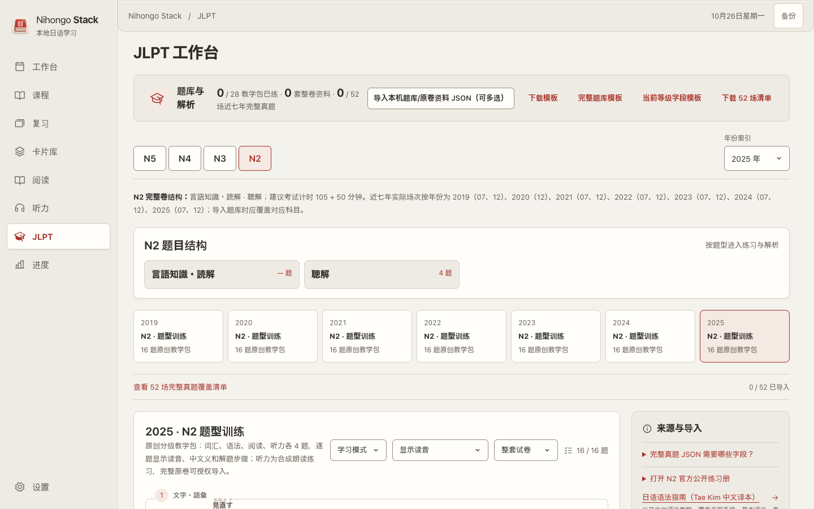

# Nihongo Stack

本机优先的日语学习工作台。打开应用先看到今天该学什么，再把课程、FSRS 复习、阅读、听力和 JLPT 练习连成一条可中断、可恢复的学习路径。


桌面版使用 MyGo 0.6.4 和 AppKit 原生窗口按钮，前端为 React 19、Vite 与 TypeScript。界面目前固定为浅色，原生窗口外观也固定为浅色，避免系统深色模式只改变标题栏控件。学习记录保存在本机 IndexedDB，不需要账户，也不会上传学习文本。

## 现在能做什么

| 入口 | 主要用途 | 当前能力 |
| --- | --- | --- |
| 工作台 | 决定下一步 | 今日任务、到期卡、新卡额度、时间预算、起点小测 |
| 课程 | 按单元学习 | 7 个连续基础单元，含词句、例句、阅读和听音入口 |
| 复习 | 巩固记忆 | FSRS 排程、单轮队列、键盘反馈、错题回看 |
| 卡片库 | 查找与整理 | 按日文、读音、中文、单元、到期状态和收藏筛选 |
| 阅读 | 读完整材料 | 学习层切换、FuriFont 注音、理解题、解析和选词说明 |
| 听力 | 做听音理解 | 本地音频、完整播放覆盖、辅助记录和听后作答 |
| JLPT | 组织备考 | N5–N2 学习索引、原创教学题、官方资料入口、授权题库导入 |
| 进度与备份 | 看见并保存变化 | 前台学习时间、一周回顾、JSON 导出和恢复预览 |

<p align="center">
  
  
</p>

<p align="center">
  
  
</p>

## 学习方式

Nihongo Stack 不把“练过”当作“掌握”，也不把页面浏览当作学习结果。

- 工作台按当前单元和真实到期状态安排任务，时间有限时可以跳过或延期。
- 卡片反馈进入 FSRS 排程；学习页记录前台活跃时间，后台、失焦和闲置不计入。
- 阅读与听音保留实际作答、播放覆盖和辅助方式，提交后才显示解析。
- JLPT 页明确区分原创教学题、官方公开资料和本机授权导入的完整题库。
- 阅读、听力、卡片例句和课程要点共用学习层，可切换原文、假名、释义和罗马音。

## 当前内容

- 62 张基础卡片
- 9 篇阅读材料
- 10 段本地音频
- 7 个连续基础单元
- 28 个年份与等级 JLPT 学习索引
- 64 道原创 JLPT 分级教学题，每级 16 道

原创材料与合成语音用于私人试用，不是经过专业日语教师审校的正式教材。完整历年试卷只通过本机授权导入，仓库不附带来源不明的试卷、音频或扫描件。

## 技术结构

| 层 | 实现 |
| --- | --- |
| 桌面壳 | MyGo 0.6.4，Go 1.27.3，macOS AppKit 原生标题栏 |
| 前端 | React 19、TypeScript、Vite 8 |
| 数据 | Dexie 与 IndexedDB |
| 复习排程 | ts-fsrs |
| 内容 | `shared/content/` 和应用内的 JLPT 索引、题库与生成脚本 |
| 构建 | MyGo 生成 macOS 应用；Vite 同时保留浏览器构建 |

业务状态留在前端，MyGo 负责窗口、原生焦点和应用生命周期。macOS 页面通过 `mygo://localhost/` 加载，浏览器版本继续使用普通 Vite 页面。

## 本地运行

需要 macOS、Go 1.27.3、Node.js 和 npm。

```sh
cd apps/nihongo-stack
npm ci

# 浏览器开发
npm run dev

# MyGo 原生开发窗口
npm run mygo:dev

# 构建并同步 macOS 应用
npm run mygo:build
```

正式入口是 `apps/nihongo-stack/Nihongo Stack.app`。

## 验证

```sh
cd apps/nihongo-stack
npm run test:db
npm run test:learning
npm run test:content
npm run test:language
npm run test:jlpt
npm run test:study-plan
npm run build
npm run mygo:vet
npm run mygo:build
codesign --verify --deep --strict 'Nihongo Stack.app'
```

## 数据与交付

- 数据库名称保留为 `nihongo-stack-codex`，现有备份 JSON 继续兼容。
- 旧 Tauri 版和 MyGo 版使用不同的页面来源，不会自动共享 IndexedDB；迁移时先从旧应用导出 JSON，再在新版导入。
- 恢复前会显示双方记录数量，并保留导入前副本。
- 桌面应用目前使用本机临时签名，未做 Apple 公证。
- 桌面应用和浏览器构建使用各自的页面来源与 IndexedDB，没有自动同步。

## 文档

- [文档导航](docs/README.md)
- [应用说明与开发](apps/nihongo-stack/README.md)
- [MyGo 迁移与原生窗口验收](docs/mygo-migration.md)
- [当前产品决策](DECISIONS.md)
- [产品定位与边界](apps/nihongo-stack/PRODUCT.md)
- [界面设计记录](apps/nihongo-stack/DESIGN.md)
- [内容来源与许可](shared/content/README.md)
- [私有 JLPT 资源说明](docs/content/PRIVATE_JLPT_RESOURCES.md)
