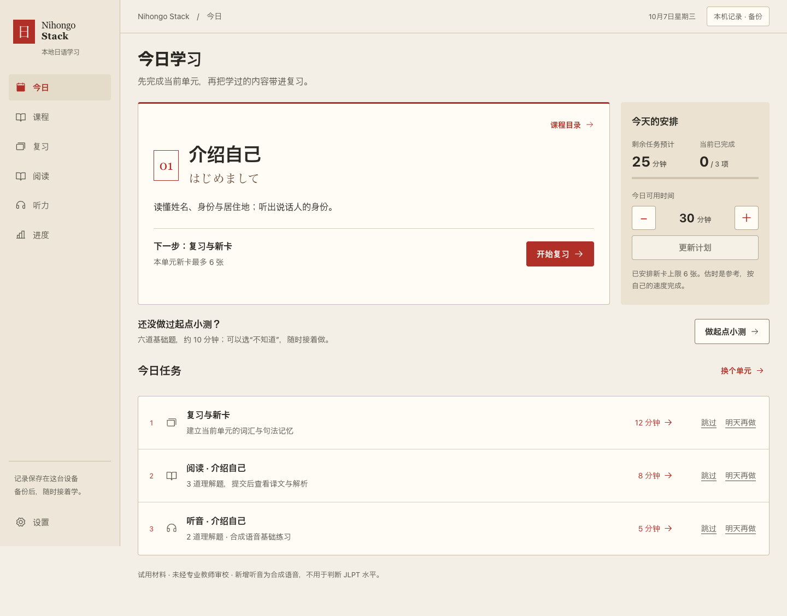
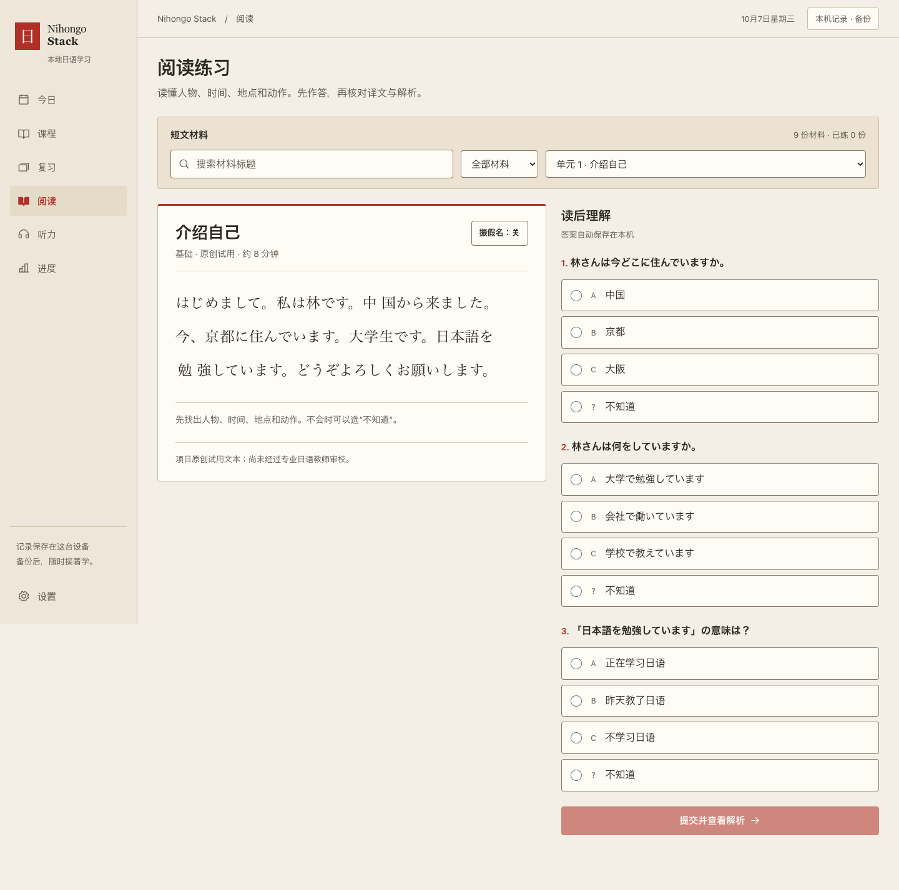
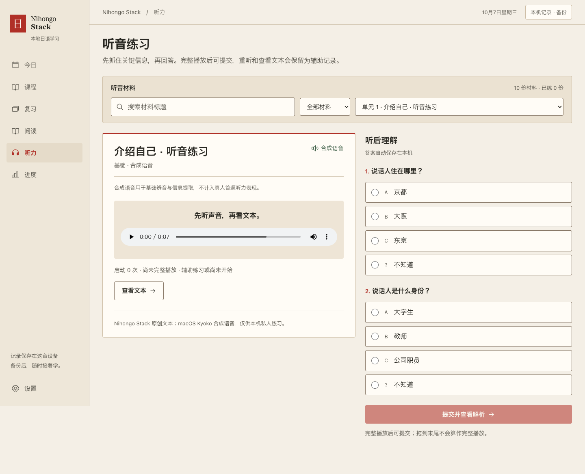
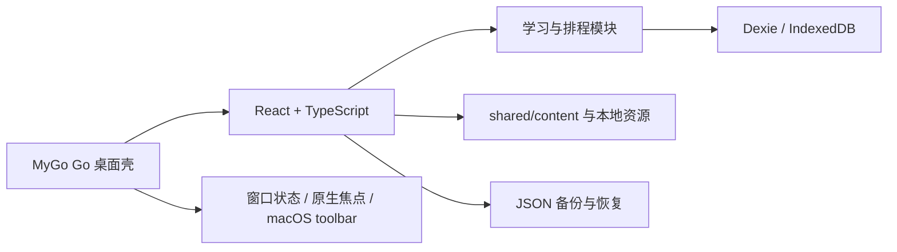
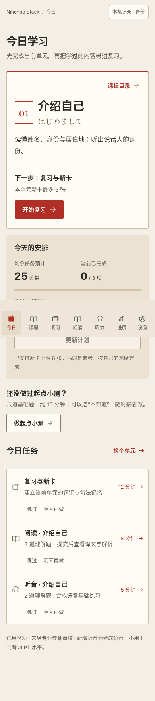

# Nihongo Stack

Nihongo Stack 是一个本机优先的日语学习应用。它把课程、间隔复习、阅读、听力、选中解释、JLPT 学习索引和本机备份放在同一个工作台里，面向 Mac 私人学习使用。



当前桌面版本使用 MyGo 0.6.4，前端仍是 React 19 + Vite + TypeScript。应用保留浏览器构建，桌面包使用 `com.nihongostack.desktop`，学习记录使用本机 IndexedDB。

## 能做什么

| 模块 | 内容 |
| --- | --- |
| 工作台 | 查看今日单元、到期卡、任务估时和下一步动作 |
| 课程 | 7 个基础单元，从自我介绍到天气与安排 |
| 复习 | FSRS 排程、分轮复习、键盘反馈和错题回顾 |
| 卡片库 | 按日文、读音、中文、单元、到期和收藏检索 |
| 阅读 | 原文、材料注音、FuriFont 注音、理解题和解析 |
| 听力 | 本地音频、播放覆盖记录、辅助证据和听后理解 |
| JLPT | N5–N2 学习索引、原创教学题和本机授权题库导入 |
| 备份 | JSON 导出、恢复预览、导入前副本和回退保护 |





## 当前内容

- 62 张基础卡片
- 9 篇阅读材料
- 10 段本地音频
- 7 个连续基础单元
- 28 个年份/等级 JLPT 学习索引
- 64 道原创分级教学题，每级 16 题
- 本地 FuriFont Serif 字体注音

原创材料和合成语音用于私人试用。它们不是教师审校教材，也不用于正式 JLPT 成绩判断。完整考试题库只通过本机授权导入，不把来源不明的试卷、音频或扫描件提交到仓库。

## 架构



业务逻辑留在前端，MyGo 负责窗口和原生生命周期。macOS 标题栏使用 AppKit 原生交通灯和统一 toolbar；页面通过 `mygo://localhost/` 加载，浏览器版本继续使用普通 Vite 页面。

## 开始使用

需要 macOS、Go 1.27.3、Node.js 和 MyGo CLI 依赖。

```sh
cd apps/nihongo-stack
npm ci

# 浏览器开发
npm run dev

# MyGo 原生开发窗口
npm run mygo:dev

# 构建正式 macOS 应用并同步到 Nihongo Stack.app
npm run mygo:build
```

正式入口是：

`apps/nihongo-stack/Nihongo Stack.app`

构建脚本会在同步后删除临时 `.app`，避免 Spotlight 出现多个同名入口。旧 Tauri 和 QA 包已移入本机废纸篓归档。

## 验证

```sh
cd apps/nihongo-stack
npm run test:db
npm run test:learning
npm run test:content
npm run test:language
npm run test:jlpt
npm run build
npm run mygo:vet
npm run mygo:build
codesign --verify --deep --strict 'Nihongo Stack.app'
```

浏览器包可以单独构建：

```sh
npm run mygo:build:web
```



## 数据兼容

数据库名称仍为 `nihongo-stack-codex`，备份 JSON schema 保持兼容。MyGo 使用 `mygo://localhost/`，旧 Tauri 使用不同页面来源，因此已有 Tauri 记录不会自动共享 IndexedDB。第一次使用 MyGo 版时，从旧应用导出 JSON，再在设置中导入即可。

## 文档

- [文档导航](docs/README.md)
- [当前产品决策](DECISIONS.md)
- [MyGo 迁移记录](docs/mygo-migration.md)
- [应用使用说明](apps/nihongo-stack/README.md)
- [产品说明](apps/nihongo-stack/PRODUCT.md)
- [内容许可](shared/content/README.md)
- [私有 JLPT 资源说明](docs/content/PRIVATE_JLPT_RESOURCES.md)

## 内容与许可

代码和应用结构按仓库许可发布。外部内容、词典、字体、音频和教材各自遵守来源许可；应用随包保存来源、署名和许可说明。公开分发前仍需重新核对内容许可、真人录音许可、Apple 公证和跨设备同步方案。
